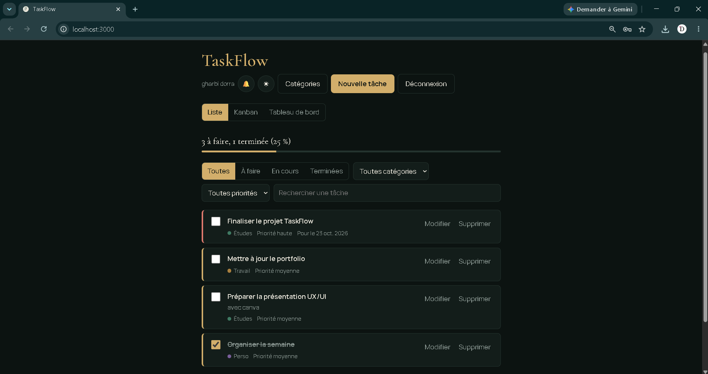
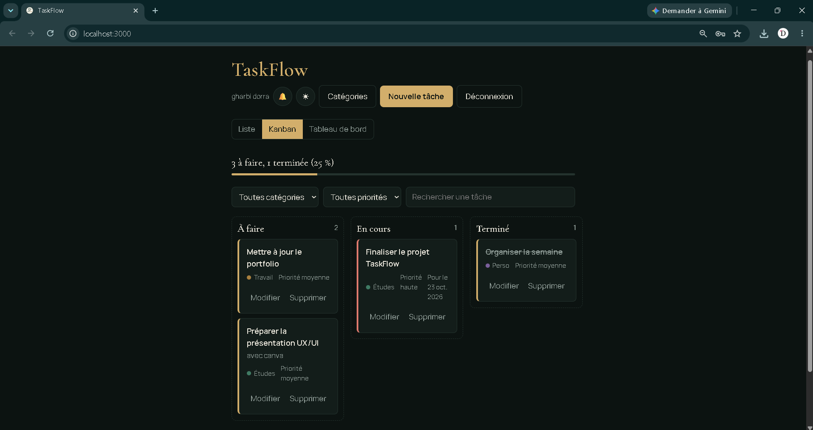
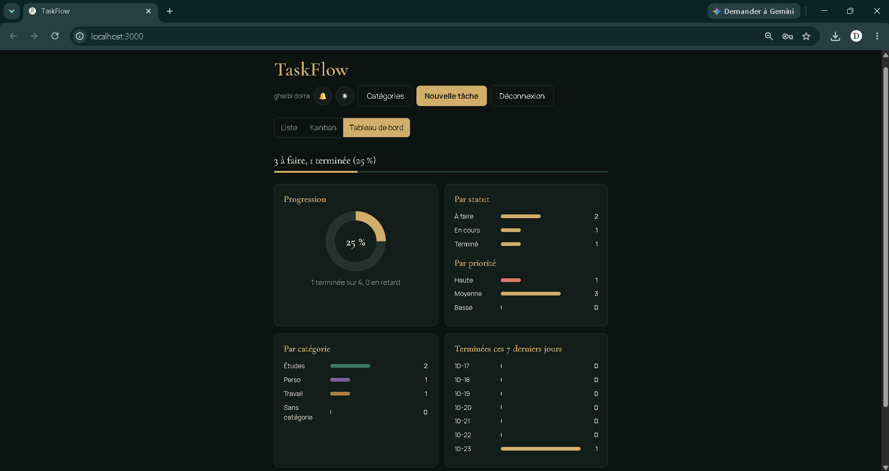

# TaskFlow

Application web de gestion de tâches, réalisée dans le cadre de ma formation en 3ᵉ année d'ingénierie multimédia. Objectif : maîtriser le fonctionnement complet d'une application web, du navigateur jusqu'à la base de données.

## Fonctionnalités
- Création de compte et connexion sécurisée (mots de passe chiffrés avec bcrypt, jeton JWT)
- Ajout, modification et suppression de tâches
- Priorités (haute, moyenne, basse), statuts (à faire, en cours, terminé) et dates d'échéance
- Vue liste et vue Kanban avec glisser-déposer
- Catégories personnalisables avec couleurs
- Tableau de bord : progression et statistiques
- Recherche et filtres (statut, priorité, catégorie)
- Mode clair et sombre, rappels pour les tâches en retard
- Données sauvegardées dans MySQL, séparées pour chaque utilisateur

## Captures d'écran





## Technologies
Node.js, Express, MySQL (mysql2), JavaScript, HTML/CSS, API REST, JWT, bcrypt

## Installation
Prérequis : Node.js (nodejs.org) et un serveur MySQL démarré.

1. Cloner le projet et ouvrir le dossier dans VS Code :
   ```
   git clone https://github.com/dorragharbi/taskflow.git
   cd taskflow
   ```
2. Installer les dépendances :
   ```
   npm install
   ```
3. Copier `.env.example` en `.env`, puis renseigner le mot de passe MySQL et une phrase secrète pour `JWT_SECRET`.
4. Lancer le serveur :
   ```
   npm start
   ```
5. Ouvrir http://localhost:3000 et créer un compte.

La base `taskflow` et les tables (`users`, `categories`, `tasks`) sont créées automatiquement au premier lancement.

## Architecture
```
Navigateur (public/app.js)  --fetch JSON-->  API REST (server.js)  --SQL-->  MySQL
```

| Route | Rôle |
|---|---|
| `POST /api/auth/register`, `POST /api/auth/login` | Inscription et connexion |
| `GET/POST /api/categories`, `DELETE /api/categories/:id` | Catégories de l'utilisateur |
| `GET/POST /api/tasks`, `PUT/DELETE /api/tasks/:id` | Tâches de l'utilisateur |

Toutes les routes, sauf l'inscription et la connexion, exigent un jeton JWT. Chaque requête SQL est filtrée par utilisateur.

## Ce que j'ai appris
Architecture client-serveur, conception d'une API REST, modélisation d'une base relationnelle (utilisateurs, catégories, tâches), authentification, sécurité (validation des données, requêtes SQL paramétrées, mots de passe chiffrés) et conception d'interface.

## Auteure
Dorra Gharbi, étudiante en 3ᵉ année IM
